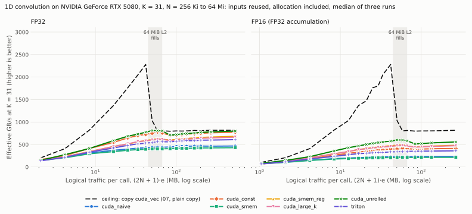

# Results

[← 1D Convolution](../README.md) · [Design](design.md) · **Results** · [Testing](testing.md) ·
[Benchmarking](benchmarking.md) · [Profiling](profiling.md)

**Session:** 2026-11-14 PST, cuda.0, RTX 5080 (84 SMs, 64 MiB L2), CUDA toolkit 13.4.92,
PyTorch 2.14.1 (CUDA 13.0, cuDNN 9.24), Triton 3.8.0, driver 615.71.09. Clocks unlocked; no
other compute processes. The sweep passed its correctness gate first: 622 tests passed, and
Compute Sanitizer reported 0 errors and 0 hazards (see [testing](testing.md)).

Each value is the **median of three run medians**, each from 100 CUDA-event samples after 25
warm-ups, with inputs reused and output allocation included. Run-median spread: median 0.3%, max 8.5%, 13 of 580 over 5%;
every cell over 5% is a call of 18 µs or less. The JSON records no commit: the code ran from
a synced copy identical to this tree. Compact evidence:
[measured_summary.json](../benchmarks/measured_summary.json).

**Ceilings (measured).** FFMA: **58.9 TFLOP/s** at a sustained 2842 MHz (58.6–58.9 over the
three runs; 61.1 theoretical at that clock). Bandwidth: 07's `cuda_vec` copy at N = 2²⁴,
**802 GB/s** (FP32) and 812 GB/s (FP16). Ridge: 58.9 TFLOP/s / 802 GB/s = 73 FLOP/B, which is
**K ≈ 294 in FP32** and K ≈ 145 in FP16 (intensity ≈ K/e).

## K sweep: the roofline (N = 2²⁴)

Latency and achieved TFLOP/s:

| FP32 µs / TFLOP/s | K=1 | K=3 | K=7 | K=15 | K=31 | K=63 | K=127 | K=255 | K=511 | K=1023 | K=2047 |
|---|---:|---:|---:|---:|---:|---:|---:|---:|---:|---:|---:|
| `cuda_naive` | 166 / 0.2 | 167 / 0.6 | 168 / 1.4 | 174 / 2.9 | 290 / 3.6 | 574 / 3.7 | 1,135 / 3.8 | 2,260 / 3.8 | 4,511 / 3.8 | 9,043 / 3.8 | 18,132 / 3.8 |
| `cuda_const` | 169 / 0.2 | 169 / 0.6 | 170 / 1.4 | 171 / 3.0 | 188 / 5.5 | 299 / 7.1 | 581 / 7.3 | 1,151 / 7.4 | 2,297 / 7.5 | 4,660 / 7.4 | 9,326 / 7.4 |
| `cuda_smem` | 166 / 0.2 | 170 / 0.6 | 176 / 1.3 | 202 / 2.5 | 323 / 3.2 | 592 / 3.6 | 1,151 / 3.7 | 2,265 / 3.8 | 4,505 / 3.8 | 8,987 / 3.8 | 17,981 / 3.8 |
| `cuda_smem_reg` | 229 / 0.1 | 226 / 0.4 | 218 / 1.1 | 213 / 2.4 | 211 / 4.9 | 219 / 9.7 | 276 / 15.5 | 430 / 19.9 | 762 / 22.5 | 1,470 / 23.4 | 2,989 / 23.0 |
| `cuda_large_k` | 232 / 0.1 | 225 / 0.4 | 225 / 1.0 | 221 / 2.3 | 217 / 4.8 | 221 / 9.6 | 249 / 17.1 | 364 / 23.5 | 650 / 26.4 | 1,249 / 27.5 | 2,482 / 27.7 |
| `cuda_unrolled` | — | 197 / 0.5 | 203 / 1.2 | — | 180 / 5.8 | — | — | — | — | — | — |
| `triton` | 171 / 0.2 | 170 / 0.6 | 170 / 1.4 | 170 / 3.0 | 228 / 4.6 | 435 / 4.9 | 859 / 5.0 | 1,706 / 5.0 | 3,421 / 5.0 | 6,863 / 5.0 | 13,730 / 5.0 |

| FP16 µs / TFLOP/s | K=1 | K=3 | K=7 | K=15 | K=31 | K=63 | K=127 | K=255 | K=511 | K=1023 | K=2047 |
|---|---:|---:|---:|---:|---:|---:|---:|---:|---:|---:|---:|
| `cuda_naive` | 69 / 0.5 | 83 / 1.2 | 87 / 2.7 | 151 / 3.3 | 292 / 3.6 | 574 / 3.7 | 1,136 / 3.8 | 2,259 / 3.8 | 4,507 / 3.8 | 9,000 / 3.8 | 17,987 / 3.8 |
| `cuda_const` | 72 / 0.5 | 86 / 1.2 | 88 / 2.7 | 99 / 5.1 | 162 / 6.4 | 301 / 7.0 | 582 / 7.3 | 1,150 / 7.4 | 2,273 / 7.5 | 4,533 / 7.6 | 9,048 / 7.6 |
| `cuda_smem` | 90 / 0.4 | 110 / 0.9 | 130 / 1.8 | 185 / 2.7 | 315 / 3.3 | 591 / 3.6 | 1,157 / 3.7 | 2,275 / 3.8 | 4,503 / 3.8 | 8,986 / 3.8 | 17,960 / 3.8 |
| `cuda_smem_reg` | 163 / 0.2 | 151 / 0.7 | 138 / 1.7 | 135 / 3.7 | 140 / 7.4 | 162 / 13.1 | 237 / 18.0 | 403 / 21.2 | 752 / 22.8 | 1,455 / 23.6 | 2,970 / 23.1 |
| `cuda_large_k` | 160 / 0.2 | 152 / 0.7 | 143 / 1.6 | 138 / 3.7 | 143 / 7.3 | 155 / 13.6 | 204 / 20.9 | 340 / 25.2 | 616 / 27.8 | 1,203 / 28.5 | 2,425 / 28.3 |
| `cuda_unrolled` | — | 149 / 0.7 | 129 / 1.8 | — | 111 / 9.4 | — | — | — | — | — | — |
| `triton` | 86 / 0.4 | 88 / 1.1 | 86 / 2.7 | 105 / 4.8 | 192 / 5.4 | 364 / 5.8 | 723 / 5.9 | 1,432 / 6.0 | 2,849 / 6.0 | 5,685 / 6.0 | 11,361 / 6.0 |

Effective bandwidth, logical bytes (2N + 1)·e over time, against the copy ceiling:

| FP32 GB/s | K=1 | K=3 | K=7 | K=15 | K=31 | K=63 | K=127 | K=255 | K=511 | K=1023 | K=2047 |
|---|---:|---:|---:|---:|---:|---:|---:|---:|---:|---:|---:|
| copy `cuda_vec` (ceiling) | 802 | | | | | | | | | | |
| `cuda_naive` | 806 | 802 | 797 | 769 | 462 | 234 | 118 | 59 | 30 | 15 | 7 |
| `cuda_const` | 792 | 792 | 792 | 787 | 715 | 450 | 231 | 117 | 58 | 29 | 14 |
| `cuda_smem` | 811 | 789 | 765 | 664 | 415 | 227 | 117 | 59 | 30 | 15 | 7 |
| `cuda_smem_reg` | 586 | 595 | 617 | 629 | 635 | 614 | 487 | 312 | 176 | 91 | 45 |
| `cuda_large_k` | 579 | 597 | 597 | 609 | 619 | 608 | 538 | 369 | 207 | 107 | 54 |
| `cuda_unrolled` | — | 681 | 660 | — | 746 | — | — | — | — | — | — |
| `triton` | 785 | 792 | 787 | 789 | 589 | 309 | 156 | 79 | 39 | 20 | 10 |

| FP16 GB/s | K=1 | K=3 | K=7 | K=15 | K=31 | K=63 | K=127 | K=255 | K=511 | K=1023 | K=2047 |
|---|---:|---:|---:|---:|---:|---:|---:|---:|---:|---:|---:|
| copy `cuda_vec` (ceiling) | 812 | | | | | | | | | | |
| `cuda_naive` | 970 | 804 | 768 | 444 | 229 | 117 | 59 | 30 | 15 | 7 | 4 |
| `cuda_const` | 929 | 777 | 759 | 679 | 414 | 223 | 115 | 58 | 30 | 15 | 7 |
| `cuda_smem` | 748 | 610 | 515 | 364 | 213 | 113 | 58 | 29 | 15 | 7 | 4 |
| `cuda_smem_reg` | 411 | 444 | 488 | 498 | 479 | 415 | 284 | 167 | 89 | 46 | 23 |
| `cuda_large_k` | 420 | 440 | 469 | 487 | 470 | 432 | 328 | 198 | 109 | 56 | 28 |
| `cuda_unrolled` | — | 450 | 519 | — | 605 | — | — | — | — | — | — |
| `triton` | 784 | 766 | 776 | 639 | 350 | 184 | 93 | 47 | 24 | 12 | 6 |

FP16 at N = 2²⁴ sits on the L2 boundary (one call's 2·N·e is exactly 64 MiB), so at K ≤ 3
some FP16 kernels report more than the copy ceiling: part of the working set stays in L2.
FP32 at this N is fully DRAM-bound.

## N sweep: the L2 boundary (K = 31)

| FP32 GB/s, K=31 | 0.25 M | 0.5 M | 1 M | 2 M | 3 M | 4 M | 5 M | 6 M | 7 M | 8 M | 10 M | 12 M | 14 M | 16 M | 20 M | 24 M | 32 M | 64 M |
|---|---:|---:|---:|---:|---:|---:|---:|---:|---:|---:|---:|---:|---:|---:|---:|---:|---:|---:|
| copy `cuda_vec` (ceiling) | 203 | 408 | 817 | 1369 | 1761 | 2048 | 2280 | 1033 | 802 | 806 | 796 | 802 | 799 | 802 | 813 | 808 | 818 | 817 |
| `cuda_naive` | 147 | 229 | 309 | 373 | 397 | 421 | 427 | 440 | 443 | 439 | 446 | 457 | 460 | 462 | 466 | 466 | 463 | 467 |
| `cuda_const` | 164 | 257 | 411 | 548 | 648 | 700 | 726 | 750 | 779 | 758 | 703 | 710 | 719 | 734 | 740 | 749 | 761 | 774 |
| `cuda_smem` | 147 | 206 | 294 | 343 | 373 | 387 | 395 | 404 | 405 | 406 | 409 | 416 | 416 | 415 | 421 | 424 | 426 | 430 |
| `cuda_smem_reg` | 147 | 229 | 342 | 456 | 513 | 557 | 589 | 612 | 627 | 616 | 600 | 613 | 625 | 635 | 646 | 656 | 667 | 682 |
| `cuda_large_k` | 147 | 228 | 339 | 456 | 515 | 566 | 581 | 602 | 613 | 616 | 587 | 601 | 609 | 618 | 629 | 637 | 646 | 664 |
| `cuda_unrolled` | 148 | 275 | 412 | 587 | 685 | 731 | 774 | 811 | 808 | 804 | 709 | 720 | 737 | 743 | 757 | 769 | 781 | 799 |
| `triton` | 137 | 217 | 329 | 423 | 483 | 515 | 533 | 543 | 564 | 563 | 559 | 573 | 581 | 587 | 584 | 597 | 599 | 609 |
| `pytorch` | 48 | 56 | 61 | 64 | 64 | 65 | 65 | 65 | 65 | 65 | 65 | 65 | 65 | 66 | 66 | 66 | 66 | 66 |

| FP16 GB/s, K=31 | 0.25 M | 0.5 M | 1 M | 2 M | 3 M | 4 M | 5 M | 6 M | 7 M | 8 M | 10 M | 12 M | 14 M | 16 M | 20 M | 24 M | 32 M | 64 M |
|---|---:|---:|---:|---:|---:|---:|---:|---:|---:|---:|---:|---:|---:|---:|---:|---:|---:|---:|
| copy `cuda_vec` (ceiling) | 104 | 206 | 410 | 822 | 1032 | 1365 | 1473 | 1761 | 1803 | 2052 | 2280 | 1033 | 803 | 812 | 798 | 802 | 803 | 817 |
| `cuda_naive` | 74 | 114 | 149 | 187 | 199 | 210 | 214 | 218 | 221 | 224 | 227 | 228 | 228 | 229 | 232 | 235 | 234 | 234 |
| `cuda_const` | 68 | 112 | 179 | 265 | 302 | 335 | 350 | 367 | 383 | 386 | 399 | 402 | 414 | 409 | 395 | 399 | 406 | 413 |
| `cuda_smem` | 73 | 103 | 147 | 178 | 187 | 195 | 199 | 205 | 205 | 208 | 209 | 211 | 215 | 213 | 211 | 214 | 215 | 215 |
| `cuda_smem_reg` | 74 | 129 | 206 | 294 | 344 | 390 | 410 | 432 | 444 | 456 | 475 | 484 | 496 | 470 | 446 | 454 | 465 | 482 |
| `cuda_large_k` | 74 | 129 | 206 | 294 | 344 | 391 | 403 | 421 | 435 | 444 | 458 | 475 | 480 | 467 | 441 | 448 | 455 | 474 |
| `cuda_unrolled` | 81 | 147 | 231 | 359 | 429 | 469 | 501 | 525 | 543 | 557 | 575 | 602 | 600 | 583 | 513 | 522 | 536 | 558 |
| `triton` | 69 | 115 | 179 | 237 | 274 | 298 | 306 | 317 | 323 | 325 | 336 | 340 | 344 | 348 | 352 | 353 | 355 | 360 |
| `pytorch` | 52 | 79 | 103 | 124 | 134 | 138 | 140 | 142 | 143 | 144 | 146 | 147 | 146 | 145 | 137 | 137 | 137 | 138 |

The copy ceiling falls off its L2 plateau between N = 5 M and 7 M in FP32 (2280 → 802 GB/s)
and between 10 M and 14 M in FP16, inside the predicted 5.6–8.4 M and 11.2–16.8 M windows
([benchmarking](benchmarking.md)). **The convolution kernels barely have an L2 cliff at K =
31.** Only the two nearest the copy ceiling lose anything when their data leaves L2:
`cuda_const` (779 → 703 GB/s from 7 M to 10 M, FP32) and `cuda_unrolled` (811 → 709), 10–13%.
The rest stay flat, because they are not bandwidth-bound even in L2: `cuda_naive` and
`cuda_smem` are LSU-bound, the register-window kernels are limited by their own small-K
overheads. Below about 1 M elements, every kernel is launch-bound (a 10–15 µs floor).

## R sweep: register blocking and register pressure

`cuda_smem_reg` at each compiled R (outputs per thread); registers and occupancy from the
K = 255 Nsight Compute reports.

| dtype | R | K=31 µs / TFLOP/s | K=255 | K=2047 | Regs | Theoretical occ. % | Achieved occ. % | FMA pipe % (K=255) |
|---|---:|---:|---:|---:|---:|---:|---:|---:|
| FP32 | 2 | 195 / 5.3 | 1,179 / 7.3 | 9,238 / 7.4 | 31 | 100 | 99 | 22 |
| FP32 | 4 | 169 / 6.2 | 616 / 13.9 | 4,669 / 14.7 | 35 | 100 | 98 | 33 |
| FP32 | 8 | 211 / 4.9 | 430 / 19.9 | 2,982 / 23.0 | 40 | 100 | 97 | 44 |
| FP32 | 16 | 275 / 3.8 | 419 / 20.4 | 2,303 / 29.8 | 56 | 67 | 64 | 39 |
| FP16 | 2 | 177 / 5.9 | 1,179 / 7.3 | 9,238 / 7.4 | 26 | 100 | 99 | 28 |
| FP16 | 4 | 115 / 9.1 | 610 / 14.0 | 4,647 / 14.8 | 40 | 100 | 98 | 39 |
| FP16 | 8 | 145 / 7.2 | 397 / 21.6 | 2,953 / 23.3 | 40 | 100 | 97 | 51 |
| FP16 | 16 | 310 / 3.4 | 428 / 20.0 | 2,247 / 30.6 | 64 | 67 | 64 | 40 |

## Profiles (Nsight Compute, N = 2²⁴, caches flushed)

Per-FMA ratios use the useful warp-FMA count, (N − K + 1)·K / 32. "LSU req" counts every
LSU/L1 request (global and shared loads and stores); "LG thr", "MIO thr" and "barrier" are
warps stalled per issued instruction.

| FP32 K=255 | µs | DRAM B/output | L1 hit % | L1 % | LSU req / warp-FMA | shared ld wavefr / warp-FMA | FMA pipe % | inst / FMA inst | LG thr | MIO thr | barrier | Regs | Warps active % |
|---|---:|---:|---:|---:|---:|---:|---:|---:|---:|---:|---:|---:|---:|
| `cuda_naive` | 2,379 | 6.54 | 99.2 | 100 | 2.008 | 0.000 | 7 | 3.58 | 38.28 | 0.20 | 0.00 | 37 | 96 |
| `cuda_const` | 1,202 | 6.56 | 99.0 | 100 | 1.008 | 0.000 | 13 | 3.21 | 16.61 | 0.18 | 0.00 | 38 | 88 |
| `cuda_smem` | 2,408 | 6.55 | 95.4 | 99 | 2.024 | 1.001 | 7 | 3.70 | 1.80 | 24.67 | 9.85 | 40 | 99 |
| `cuda_smem_reg` | 444 | 6.61 | 87.1 | 77 | 0.281 | 0.144 | 44 | 1.66 | 1.21 | 1.99 | 1.25 | 40 | 97 |
| `cuda_large_k` | 377 | 6.54 | 76.2 | 67 | 0.206 | 0.224 | 44 | 1.84 | 0.25 | 0.92 | 0.69 | 40 | 81 |
| `triton` | 1,794 | 6.56 | 99.5 | 100 | 1.506 | 0.000 | 11 | 5.73 | 11.54 | 0.08 | 0.00 | 23 | 93 |

| FP32 K=2047 | µs | DRAM B/output | L1 hit % | L1 % | LSU req / warp-FMA | shared ld wavefr / warp-FMA | FMA pipe % | inst / FMA inst | LG thr | MIO thr | barrier | Regs | Warps active % |
|---|---:|---:|---:|---:|---:|---:|---:|---:|---:|---:|---:|---:|---:|
| `cuda_naive` | 19,221 | 6.59 | 99.7 | 99 | 2.001 | 0.000 | 6 | 3.40 | 43.63 | 0.03 | 0.00 | 37 | 99 |
| `cuda_const` | 9,846 | 6.62 | 99.6 | 97 | 1.001 | 0.000 | 12 | 2.97 | 21.63 | 0.03 | 0.00 | 38 | 98 |
| `cuda_smem` | 19,176 | 6.60 | 97.4 | 99 | 2.011 | 1.000 | 7 | 3.43 | 4.02 | 33.37 | 3.63 | 40 | 100 |
| `cuda_smem_reg` | 2,834 | 6.58 | 93.7 | 87 | 0.256 | 0.128 | 54 | 1.55 | 0.38 | 1.20 | 1.27 | 40 | 98 |
| `cuda_large_k` | 2,381 | 6.56 | 59.1 | 72 | 0.179 | 0.206 | 54 | 1.70 | 0.02 | 0.17 | 0.56 | 40 | 82 |
| `triton` | 14,489 | 6.59 | 99.8 | 99 | 1.501 | 0.000 | 10 | 5.68 | 12.38 | 0.01 | 0.00 | 23 | 98 |

| FP32 K=31 | µs | DRAM B/output | L1 hit % | L1 % | LSU req / warp-FMA | shared ld wavefr / warp-FMA | FMA pipe % | inst / FMA inst | LG thr | MIO thr | barrier | Regs | Warps active % |
|---|---:|---:|---:|---:|---:|---:|---:|---:|---:|---:|---:|---:|---:|
| `cuda_naive` | 305 | 6.52 | 95.4 | 99 | 2.065 | 0.000 | 9 | 4.70 | 16.27 | 0.74 | 0.00 | 37 | 88 |
| `cuda_const` | 175 | 6.52 | 94.5 | 94 | 1.065 | 0.000 | 13 | 5.00 | 2.73 | 0.30 | 0.00 | 38 | 78 |
| `cuda_smem` | 333 | 6.56 | 78.4 | 93 | 2.137 | 1.008 | 8 | 5.58 | 1.70 | 7.55 | 5.25 | 40 | 95 |
| `cuda_smem_reg` | 205 | 6.53 | 79.3 | 60 | 0.497 | 0.279 | 12 | 2.60 | 5.76 | 6.82 | 2.71 | 40 | 96 |
| `cuda_large_k` | 209 | 6.52 | 77.1 | 58 | 0.438 | 0.370 | 10 | 3.03 | 2.91 | 5.83 | 2.82 | 40 | 79 |
| `cuda_unrolled` | 167 | 6.53 | 78.1 | 53 | 0.388 | 0.172 | 12 | 2.33 | 2.19 | 4.65 | 2.14 | 48 | 79 |
| `triton` | 238 | 6.56 | 97.1 | 97 | 1.548 | 0.000 | 11 | 6.19 | 8.35 | 0.52 | 0.00 | 23 | 91 |

| FP32 K=3 | µs | DRAM B/output | L1 hit % | L1 % | LSU req / warp-FMA | shared ld wavefr / warp-FMA | FMA pipe % | inst / FMA inst | LG thr | MIO thr | barrier | Regs | Warps active % |
|---|---:|---:|---:|---:|---:|---:|---:|---:|---:|---:|---:|---:|---:|
| `cuda_naive` | 127 | 6.09 | 61.2 | 31 | 2.667 | 0.000 | 5 | 7.88 | 0.01 | 0.05 | 0.00 | 37 | 77 |
| `cuda_const` | 127 | 6.12 | 54.8 | 19 | 1.667 | 0.000 | 3 | 12.80 | 0.00 | 0.04 | 0.00 | 38 | 76 |
| `cuda_smem` | 148 | 6.56 | 26.9 | 33 | 3.417 | 1.020 | 4 | 12.20 | 0.00 | 0.15 | 3.99 | 40 | 89 |
| `cuda_smem_reg` | 215 | 6.53 | 77.2 | 62 | 1.885 | 0.743 | 2 | 7.21 | 22.83 | 15.79 | 9.25 | 40 | 93 |
| `cuda_large_k` | 215 | 6.55 | 77.0 | 61 | 1.896 | 0.872 | 1 | 9.01 | 11.03 | 12.05 | 9.34 | 40 | 79 |
| `cuda_unrolled` | 189 | 6.52 | 77.4 | 59 | 1.594 | 0.468 | 2 | 5.16 | 21.07 | 25.75 | 13.01 | 30 | 95 |
| `triton` | 109 | 5.57 | 76.7 | 28 | 2.000 | 0.000 | 4 | 8.33 | 0.02 | 0.01 | 0.00 | 23 | 86 |

FP16 profiles (same columns) are in [measured_summary.json](../benchmarks/measured_summary.json)
and show the same ordering.

**DRAM traffic stays at its minimum for every kernel and every K.** DRAM reads are 4.00–4.03
B per output in FP32 (one `x` element) and 2.00 in FP16, from K = 3 to 2047: the K-fold
reuse of `x` and every block's halo are absorbed by L1/L2. (The column above adds writes,
which ncu undercounts at 1.6–2.6 B because dirty output lines are still in L2 when the
kernel ends; the copy kernel shows the same.)

## Halo overhead against the model

`cuda_large_k` (FP32), global elements loaded per output, measured from L1 global-load
sectors, against the model chunks + 2K/span. A block covers span = 256·R outputs; per
1024-tap chunk it loads span + taps `x` values, and it loads its K filter taps once.

| R | span (outputs/block) | K | halo (K−1)/span | model elements/output | measured | measured / model |
|---:|---:|---:|---:|---:|---:|---:|
| 16 | 4096 | 1023 | 0.250 | 1.500 | 1.500 | 1.000 |
| 16 | 4096 | 2047 | 0.500 | 3.000 | 3.000 | 1.000 |
| 16 | 4096 | 255 | 0.062 | 1.125 | 1.125 | 1.000 |
| 16 | 4096 | 31 | 0.007 | 1.015 | 1.016 | 1.000 |
| 2 | 512 | 1023 | 1.996 | 4.996 | 5.000 | 1.001 |
| 2 | 512 | 2047 | 3.996 | 9.996 | 10.000 | 1.000 |
| 2 | 512 | 255 | 0.496 | 1.996 | 2.000 | 1.002 |
| 2 | 512 | 31 | 0.059 | 1.121 | 1.125 | 1.003 |
| 4 | 1024 | 1023 | 0.998 | 2.998 | 3.000 | 1.001 |
| 4 | 1024 | 2047 | 1.998 | 5.998 | 6.000 | 1.000 |
| 4 | 1024 | 255 | 0.248 | 1.498 | 1.500 | 1.001 |
| 4 | 1024 | 31 | 0.029 | 1.061 | 1.062 | 1.002 |
| 8 | 2048 | 1023 | 0.499 | 1.999 | 2.000 | 1.001 |
| 8 | 2048 | 2047 | 0.999 | 3.999 | 4.000 | 1.000 |
| 8 | 2048 | 255 | 0.124 | 1.249 | 1.250 | 1.001 |
| 8 | 2048 | 31 | 0.015 | 1.030 | 1.031 | 1.001 |

## Answers

### 1. Does shared-memory staging pay for its barriers at small K, or does L1 already do the job?

**L1 already does the job; staging alone never pays.** `cuda_smem` is slower than
`cuda_naive` at every small K (FP32: 202 vs 174 µs at K = 15, 323 vs 290 µs at K = 31) and
merely equal at large K (17,981 vs 18,132 µs at K = 2047). The naive kernel's L1 hit rate is
95.4% at K = 31 and 99%+ from K = 255. Staging adds barrier stalls (4.0 per issued
instruction at K = 3) and does not reduce the limiter: requests per warp-FMA stay at 2.0
(one shared load replaces one global load, and `w` is still a global load), with the L1 data
path 93–99% busy. The README's question gets a sharp answer: shared memory only pays once
registers reuse what it holds (`cuda_smem_reg`, 0.26–0.50 requests per warp-FMA).

### 2. How does halo overhead scale with BLOCK and K?

**Exactly as modelled, and only in L1/L2 traffic.** Measured global elements per output match
chunks + 2K/span to within 0.3% for every span (512–4096) and K (31–2047): the halo term
(K − 1)/span grows linearly with K and inversely with the block's output span, from 0.007 (K
= 31, span 4096) to 4.0 (K = 2047, span 512). None of it reaches DRAM (4.00 B read per FP32
output at every K), so halo overhead costs L1/L2 bandwidth and load instructions, not DRAM
bandwidth. Larger spans cut it, which is one of the two reasons larger R helps at large K.

### 3. At what K does each variant stop being memory-bound?

Taking "memory-bound" as within 10% of the 802 GB/s copy ceiling (FP32, N = 2²⁴):

| Variant | Memory-bound up to | Then limited by |
|---|---|---|
| `cuda_naive`, `triton` | K = 15 (769, 789 GB/s) | LSU/L1 requests: 2.0 (naive) / 1.5 (Triton) per warp-FMA, L1 99–100% busy, from K = 31 (462, 589 GB/s) |
| `cuda_smem` | K = 7 (765 GB/s) | The same requests plus barriers, from K = 15 |
| `cuda_const` | K = 15 (787 GB/s); 89% at K = 31 | LSU requests, halved: 1.0 per warp-FMA, which is why it is exactly 2× naive at large K (7.4 vs 3.8 TFLOP/s) |
| `cuda_unrolled` | K = 31 (746 GB/s, 93%) | Its specializations stop at K = 31 |
| `cuda_smem_reg`, `cuda_large_k` | Never at the ceiling (579–635 GB/s at K ≤ 63) | Small-K overhead below the ridge; LSU request intake and issue slots past it (TFLOP/s flattens from K ≈ 511, past the K ≈ 294 ridge) |

Every one-output-per-thread kernel leaves the roofline at K = 15–31, long before the
ridge, onto a K-independent plateau set by L1 requests per FMA. Only the register-window
kernels keep climbing through the ridge region, but they are no longer memory-bound there
either: at FP32 K = 255 the roof is 51 TFLOP/s (63.7 FLOP/B × 802 GB/s) and they reach 19.9
(`cuda_smem_reg`, 39%) and 23.5 (`cuda_large_k`, 46%), moving 312 and 369 GB/s. No variant
is memory-bound past K = 31.

### 4. How much do register blocking and unrolling add once you are compute-bound?

**Register blocking: 6–7×; unrolling: about 18% where it applies.**

- From `cuda_smem` to `cuda_smem_reg` at K = 2047: 3.8 → 23.0 TFLOP/s (FP32), with the FMA
  pipe going from 7% to 54% active and shared-load wavefronts per warp-FMA from 1.000 to
  0.128 (the predicted 1/R = 0.125, conflict-free padding included). Staging `w` in shared
  memory too (`cuda_large_k`) reaches 27.7 TFLOP/s; R = 16 reaches 29.8 at K = 2047.
- **The remaining limit is still the LSU request intake.** Reaching FFMA peak needs at most 0.125 requests per warp-FMA (L1 takes
  about 0.5 per clock, the FMA pipe does 4 warp-FMAs). `cuda_smem_reg` issues 0.256 (one
  shared load and one `w` load per 8 FMAs), with request intake 87% busy, which caps it near
  50% of peak; 54% FMA activity was measured. `cuda_large_k` gets to 0.179 and is then
  issue-bound (85% of issue slots, 1.7 instructions per FMA).
- **R = 16 trades occupancy for requests.** 56 registers drop theoretical occupancy from
  100% to 67%: R = 16 wins at K = 2047 (29.8 vs 23.0 TFLOP/s) but loses at K = 31 (3.8 vs
  4.9) and only ties at K = 255 (20.4 vs 19.9).
- **Unrolling (`cuda_unrolled`) helps only at K = 31,** where its single-tile,
  loop-free kernel is the fastest variant: 180 µs vs 211 µs for `cuda_smem_reg` (FP32,
  +17%), and 93% of the copy ceiling. At K = 3 and 7 it shares the register-window kernels'
  small-K overhead and is slower than the naive kernel (197 vs 167 µs at K = 3).

## Other findings

- **The register-window kernels are 25–30% slower than naive at K ≤ 15** (FP32 586–629 vs
  769–806 GB/s). At K = 3 their issue slots are only 10% busy and LSU intake 12%, yet warps
  stall on LG throttle (22.8 per instruction) and barriers (9.3), and DRAM runs at 509 GB/s.
  Each thread stores R consecutive outputs, so a warp's scalar store spans 32·R elements;
  the likely cost is this store pattern plus the per-block load/barrier/compute/store
  serialization. Staging the output tile through shared memory for coalesced stores is the
  next experiment; it is not done here.
- **The `cuda` alias is not the best kernel at every K.** `cuda_smem_reg` is the best
  general-purpose choice past K ≈ 63, but `cuda_const` (K ≤ 31) and `cuda_unrolled` (K = 31)
  beat it below, and `cuda_large_k` beats it at every K ≥ 127. A K-based dispatch would be
  faster everywhere; the alias is left as chosen.
- **`cuda_const`'s filter really leaves the LSU pipe:** in its SASS, the compiler loads taps
  into uniform registers (`LDCU`) and every FFMA reads its tap from one (`FFMA R7, R7, UR14,
  R0`). Requests per warp-FMA fall from 2.0 to 1.0 and throughput doubles, the cleanest
  confirmation of the request-count model.
- **cuDNN is 12× (FP32) and 4× (FP16) slower than the best CUDA kernel at K = 31** (66 vs
  799 and 138 vs 558 GB/s at N = 64 M) and was not timed in the K sweep; its FP16 path falls back to a generic kernel from
  K = 255 ([design §4](design.md#4-triton-the-naive-stencil-measured)).

## Limitations

- One GPU, one session, unlocked clocks. The FFMA ceiling is measured per run; DRAM ceilings
  are a copy kernel's, not a hardware specification.
- The register-window kernels' small-K slowdown is diagnosed from stall reasons, not from an
  experiment that removes the suspected cause.
- R was swept only for `cuda_smem_reg`, at 256 threads per block; block size was not swept
  separately, so "BLOCK" in the halo model is the output span 256·R.
- `cuda_unrolled` exists only for K = 3, 7, 31; the JAX baseline is not implemented.
- FP16 at N = 2²⁴ is partly L2-resident at small K (see the K-sweep note); BF16 was tested
  for correctness but not benchmarked.
