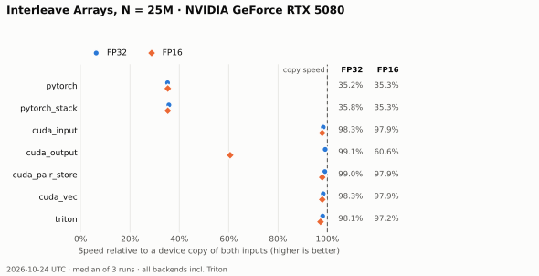

# 04 · Interleave Arrays

`out[2i] = A[i]`, `out[2i+1] = B[i]`: two contiguous inputs, one alternating output. A
data-movement kernel for studying how to map threads when reads and writes have different
shapes, and why every 32-byte sector should be written in one go.

**Status:** ✅ Complete (CUDA, PyTorch and Triton) · validated and measured on
NVIDIA GeForce RTX 5080 · primary lesson: **lane-to-output mapping** · prerequisite:
[01 · Vector Addition](../vector_add/README.md).



The figure and benchmark tables include three matched runs of every backend,
including Triton (2026-10-23 PDT / 2026-10-24 UTC). Earlier Nsight findings are
labeled separately in [results](docs/results.md).

## Key results

RTX 5080, N = 25M (DRAM-bound). A device copy of both inputs moves the same bytes, so it is
the practical speed limit. Details are in [results](docs/results.md).

- **Triton is close to the CUDA kernels:** at N=25M it takes 498.2 / 251.2 /
  250.6 µs in FP32/FP16/BF16, about 97–98% of same-run copy speed.
- **Thread-per-input mapping works for every dtype:** `cuda_input`, `cuda_pair_store` and
  `cuda_vec` reach 97–99% of copy speed. Stride-2 stores cost nothing when the same warp
  fills both halves of each 32-byte sector, because the sector is complete in L2 before
  it reaches DRAM.
- **Thread-per-output mapping fails for 2-byte types:** `cuda_output` runs its loads and
  stores with half the warp active, so in FP16 each request carries only 32 bytes and DRAM
  is 48% busy: 60% of copy speed (99% in FP32).
- **PyTorch is 2.8× slower than a copy.** `out[0::2] = a; out[1::2] = b` writes each sector
  in two separate passes, so the L2 must read the old sector from DRAM before every write:
  about 2.4× the lower bound on traffic, at lower DRAM efficiency. `torch.stack` has the same
  problem.
- **Instruction count does not matter here:** from 0.30 (`cuda_vec`) to 1.75 (`cuda_output`)
  instructions per element, the FP32 times are the same.

## Documentation

| Page | Contents |
|---|---|
| [Design](docs/design.md) | Contract, the mapping problem, performance model, the variants |
| [Results](docs/results.md) | Latency per backend, profiling (why the variants differ), PyTorch's read-modify-write, limitations |
| [Testing](docs/testing.md) | Test cases, running the suite, Compute Sanitizer |
| [Benchmarking](docs/benchmarking.md) | Commands, copy reference of both inputs, sizes, reproduction |
| [Profiling](docs/profiling.md) | Capturing one launch, report sections, metrics and how to read them |

## Quick start

From the repository root, after [setup](../vector_add/docs/testing.md#setup):

```bash
python -m pytest -q problems/interleave_arrays
python -m lab.bench interleave_arrays --copy-reference --peak-gb-s 960
```

```python
import torch

from problems.interleave_arrays.api import interleave

a = torch.tensor([1.0, 2.0, 3.0], device="cuda")
b = torch.tensor([4.0, 5.0, 6.0], device="cuda")
# Backends: pytorch, pytorch_stack, cuda_input, cuda_output, cuda_pair_store, cuda_vec, triton
interleave(a, b, backend="cuda_pair_store")  # [1, 4, 2, 5, 3, 6]
```

## Layout

```text
interleave_arrays/
├── README.md        overview (this page)
├── api.py           public entry point, contract, backends and tolerances
├── cases.py         sizes (every N mod 8) and value distributions
├── pytorch/         reference (two strided copies) and torch.stack baseline
├── cuda/            input, output, pair-store and vec kernels, bindings, loader
├── triton/          tiled loads, register interleave, contiguous output stores
├── tests/           source examples, output order, offsets, every backend vs the reference
├── benchmarks/      sweep.sh (benchmarks + Nsight reports), plot.py
├── figures/         generated chart (tracked)
└── docs/            design, results, testing, benchmarking, profiling
```
