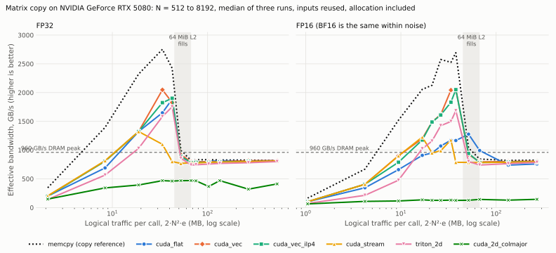

# 07 · Matrix Copy

Copy an N × N matrix, bit for bit. No arithmetic, so the copy measures the memory system
itself: how close a kernel gets to the driver's memcpy, where the L2 cache stops helping,
and what coalescing, vector width, ILP and cache hints are worth. It is the control
experiment for [08 · Matrix Transpose](../matrix_transpose/README.md).

**Status:** PyTorch, CUDA (8 variants) and Triton (2 layouts) implemented, validated and
measured on RTX 5080. 1436 GPU correctness tests passed; Compute Sanitizer memcheck: 1076
passed, zero errors. Source: [LeetGPU Matrix Copy](https://leetgpu.com/challenges/matrix-copy)
(N × N float32, 1 ≤ N ≤ 4096; performance case N = 4096).



## Key results

- **Coalesced kernels match memcpy when DRAM-bound.** memcpy reaches 819–828 GB/s (85–86%
  of the nominal 960 GB/s). At 8192² FP32 every coalesced kernel is within 2.5% of it; at
  the source's 4096² FP32, `cuda_flat` is at 98.6% (164.5 vs 162.2 µs).
- **The L2 cliff follows the resident footprint, not the traffic.** The benchmark keeps two
  output blocks alive (3·N²·e), so FP32 drops between 2304² and 2560². With one reused
  output (2·N²·e) it drops between 2896² and 3072²: FP32 2560² runs 2.8× faster that way,
  FP16 4096² 3.3×. Below the cliff, memcpy reaches 2.75 TB/s.
- **Uncoalesced costs L2 transactions, not DRAM bytes.** The column-major kernel touches 32
  sectors per request but reads only 15% more DRAM than the minimum. It is L2-bound:
  2.0× slower than memcpy in FP32, 5.7× in FP16, up to 19× when the data is in L2.
- **Vectorization matters for 2-byte elements and in L2, ILP does not.** DRAM-bound FP32
  gains nothing from 16-byte packs. FP16 kernel time halves (75.7 → 39.3 µs, 60% → 94.5%
  DRAM busy). More packs per thread or a grid-stride loop only add LG-throttle stalls and
  run 0.2–2.3% slower.
- **Streaming hints only hurt.** `__ldcs`/`__stcs` throw away reuse between calls (2.3×
  slower at 2304² FP32) and gain nothing above L2.
- **Triton matches CUDA when DRAM-bound** (within 1.3–2.6%) and vectorizes to 16-byte
  accesses on its own; its call costs about 4 µs more.

`cuda_vec` is the recommended kernel: within 3% of memcpy DRAM-bound in every dtype and the
fastest kernel in L2.

## Documentation

| Page | Contents |
|---|---|
| [Design](docs/design.md) | Contract, variants and hypotheses, bit-level copying, traffic and footprint |
| [Results](docs/results.md) | Three-run tables, the L2 cliff, Nsight evidence, SASS, answers and limitations |
| [Testing](docs/testing.md) | Bit-exact suite, misalignment, binding checks, sanitizer |
| [Benchmarking](docs/benchmarking.md) | Reproduce the sweep and what one sample measures |
| [Profiling](docs/profiling.md) | Nsight captures, metric definitions and the warm-capture caveat |

## Quick start

```bash
python -m pytest -q problems/matrix_copy
PYTHON=python bash problems/matrix_copy/benchmarks/sweep.sh
```

```python
import torch
from problems.matrix_copy.api import matrix_copy

a = torch.randn(4096, 4096, device="cuda")
b = matrix_copy(a, backend="cuda_vec")  # a new tensor, bit-identical to a
```

Backends: `pytorch` (`clone`, a memcpy), `cuda_2d`, `cuda_2d_colmajor`, `cuda_flat` (the
`cuda` alias), `cuda_vec`, `cuda_vec_ilp2`, `cuda_vec_ilp4`, `cuda_vec_gridstride`,
`cuda_stream`, `triton` (flat) and `triton_2d` (64 × 64 tiles). CUDA takes `threads` =
128/256/512; Triton takes `block_size`, `block_m`, `block_n` and `num_warps`. FP32, FP16
and BF16; rectangular and empty matrices are lab extensions.

Raw benchmark JSON, 40 Nsight reports, CSV exports, steady-state timings and disassembly
are in `artifacts/matrix_copy/`, in this workspace and on cuda.0. Large generated files are
ignored by git; [compact evidence](benchmarks/measured_summary.json), the scripts and the
figure are tracked.

Prerequisites: [Vector Addition](../vector_add/README.md). Follow the
[optimization methodology](../../docs/methodology.md).
