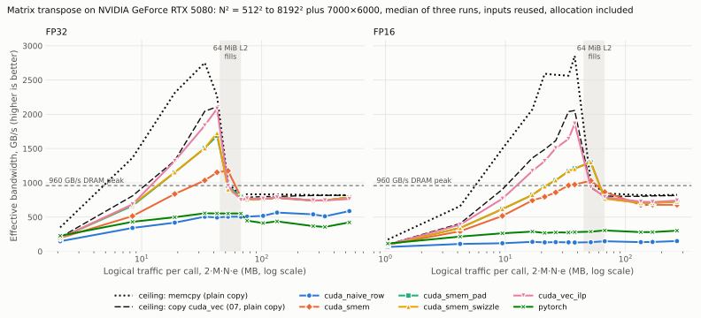

# 08 · Matrix Transpose

## Source

LeetGPU: [Matrix Transpose](https://leetgpu.com/challenges/matrix-transpose)

Source contract verified on 2026-10-24; see [design and performance model](docs/design.md).

This is an original study plan, not a reproduction of the source statement.
Source: row-major fp32, rows and cols from 1 to 8192; performance case 7000×6000.
The lab also supports fp16/bf16, empty matrices and larger dimensions.

## Prerequisites

[07 · Matrix Copy](../matrix_copy/README.md)

## Difficulty

- LeetGPU: **Easy**.

## Why this problem matters

Transpose is a flagship because one small operation exposes load/store coalescing, shared-memory layout, synchronization, and a useful bandwidth control.

## Primary lesson

**Shared-memory bank conflicts**

## Primary concepts

- Memory coalescing
- Shared memory
- Bank conflicts
- Tiled memory access

## Planned implementations

- [x] PyTorch correctness reference and materialized eager baseline
- [x] CUDA straightforward baselines: `cuda_naive_row`, `cuda_naive_col`
- [x] CUDA named optimization variants: `cuda_smem`, `cuda_smem_pad`, `cuda_smem_swizzle`,
  `cuda_vec_ilp`
- [ ] Triton implementation with explicit tile/warp choices

CUDA and Triton provide useful low-level contrasts against PyTorch. JAX is deferred until it would answer a distinct compiler or performance question rather than duplicate coverage.

Steps 0–3 complete: source verification, algorithm contract, tested correctness
reference, and a simple performance model. Steps 4–7 complete for CUDA: six variants,
validated, benchmarked and profiled on an RTX 5080. Triton remains a stub.
Run the tests with `python -m pytest problems/matrix_transpose`; reproduce the measurements
with [benchmarks/sweep.sh](benchmarks/sweep.sh) ([benchmarking](docs/benchmarking.md)).

```text
matrix_transpose/
    README.md      study plan and status
    api.py         validated public contract
    cases.py       test and benchmark inputs, bytes and FLOPs
    pytorch/       materialized transpose reference
    cuda/          kernels.cu, bindings.cpp, implementation.py (six variants)
    triton/        Triton kernel (stub)
    tests/         test_matrix_transpose.py
    benchmarks/    sweep, copy control, timeline driver, summary and plot
    docs/          design, results, benchmarking, profiling
```

## Optimization roadmap

These are candidate experiments, not promised improvements or completed code.

1. Naive global-memory transpose.
2. Shared-memory tiled transpose.
3. Pad the shared tile and compare bank conflicts.
4. Explore vector loads/stores and block dimensions.

## Correctness focus

Tile tails, rectangular lab variants, padded layouts, and synchronization for inactive lanes.

## Things to measure

- Latency and effective GB/s
- Load/store sectors
- Shared bank conflicts
- Occupancy and shared bytes/block

Separate source conformance from broader shape/dtype experiments. Use the
[benchmarking plan](../../docs/benchmarking.md) and choose
[profiler metrics](../../docs/profiling.md) for a specific hypothesis.

## Questions to answer

- Are global loads and stores both coalesced?
- Does padding change measured conflicts and latency?
- How close is performance to the copy control?

## Status

🟨 **In Progress**

CUDA: six variants implemented, validated and measured on RTX 5080. 399 GPU tests passed
(42 Triton cases skip: stub); Compute Sanitizer memcheck, racecheck, synccheck and
initcheck: 0 errors, 0 hazards. Triton pending.



### Key results

`memcpy` (`a.clone()`) and copy `cuda_vec` (07's pack kernel) are plain copies, not
transposes: they are the bandwidth ceiling a transpose can at best match, not competitors.

- **Transpose reaches 91% of the copy ceiling in FP32 and 88% in FP16** at the source's
  7000 × 6000 (`cuda_vec_ilp`, 451.9 and 233.5 µs; memcpy 409.5 and 205.0 µs), moving
  exactly the minimum DRAM bytes. Every tiled kernel is 2.1–2.6× faster than PyTorch's
  `a.t().clone()`.
- **Bank conflicts measured exactly as modelled:** unpadded column reads cost 32.1
  (FP32) and 16.1 (FP16) shared wavefronts per load; padding brings FP32 to 1.00 but
  leaves FP16 at 1.50; the XOR swizzle is 1.00 in both.
- **Conflicts matter only off DRAM.** At 7000 × 6000 the unpadded tile is 0.2% (FP32) and
  4% (FP16) slower; L2-resident at 2048² FP32 it is 1.8× slower (27.2 vs 15.0 µs).
- **Strided stores are the worse naive side,** except FP32 from DRAM: FP16 `cuda_naive_row`
  runs at 17% of the memcpy ceiling, 2.4× slower than `cuda_naive_col`.
- **With data in L2, 16-byte packs win:** `cuda_vec_ilp` is within 1–10% of the copy `cuda_vec` ceiling
  and 1.2–1.5× faster than the 32×32 tiles.

Details: [results](docs/results.md) · [benchmarking](docs/benchmarking.md) ·
[profiling](docs/profiling.md) · [design](docs/design.md).

Follow the [optimization methodology](../../docs/methodology.md) and update the
[roadmap status](../../README.md#roadmap) as work progresses.
