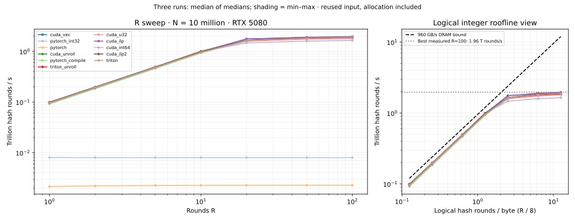

# 06 · Rainbow Table

Iterated FNV-1a over four-byte int32 values. Increasing the round count R keeps
logical traffic fixed at 8N bytes while increasing dependent integer work. This
makes one workload cross from a memory limit to an integer execution limit.

**Status:** CUDA, PyTorch and Triton implemented, validated and measured on RTX 5080.
510 GPU correctness tests passed; focused Compute Sanitizer memcheck: 238 passed,
zero errors. Source: [LeetGPU Rainbow Table](https://leetgpu.com/challenges/rainbow-table).
The source performance case is N=5M/R=10; the headline sweep uses N=10M/R=1–100.



## Key results

- **The transition is measured:** cold-profile u32 moves from 89% DRAM / 22% SM
  utilization at R=1 to 10% DRAM / 91% SM at R=100.
- **ILP helps modestly:** four chains reach 1.962 T rounds/s at R=100, 9% above
  scalar u32. Occupancy stays near 97%; dependency waits fall and math-pipe
  throttle rises. At source N=5M/R=10, vector ILP leads at 35.8 µs.
- **Generated code defines the compute model:** CUDA uses IMAD, SHF and fused
  LOP3; Triton also uses PRMT. CUDA's int64 hash has no wide-multiply sequence:
  optimization removes the high product. Static CUDA registers range from 10 to
  30 for positive R; runtime launch allocation is reported separately.
- **Triton is competitive:** looped Triton reaches 1.903 T rounds/s at R=100;
  static unroll is slightly slower. The standard FP roofline is unsuitable;
  use the integer model and pipeline counters.

## Documentation

| Page | Contents |
|---|---|
| [Design](docs/design.md) | Exact contract, variants, work and traffic |
| [Results](docs/results.md) | Three-run latency table, profiler evidence, decisions and limitations |
| [Testing](docs/testing.md) | Oracle, edge cases, GPU tests and sanitizer |
| [Benchmarking](docs/benchmarking.md) | Reproduce the sweep and interpret timing |
| [Profiling](docs/profiling.md) | What to inspect in Nsight Compute, metric definitions and reasoning |
| [SASS](docs/sass.md) | Per-round counts, byte extraction, int64 sequences and registers |
| [Integer roofline](docs/roofline.md) | Intensity, ridge, ceilings and cache caveats |

## Quick start

```bash
python -m pytest -q problems/rainbow_table
PYTHON=python bash problems/rainbow_table/benchmarks/sweep.sh
```

```python
import torch
from problems.rainbow_table.api import rainbow_table

x = torch.tensor([123, 456, 789], dtype=torch.int32, device="cuda")
rainbow_table(x, 2, backend="triton")  # uint32: [1636807824, 1273011621, 2193987222]
```

Backends: `pytorch`, `pytorch_int32`, `pytorch_compile`, `cuda_int64`, `cuda_u32`
(`cuda` alias), `cuda_ilp2`, `cuda_ilp` (four chains), `cuda_vec`, `cuda_unroll`,
`triton`, `triton_unroll`. CUDA defaults to 256 threads; Triton to block size 256
and 4 warps. All return a fresh uint32 tensor. Empty input, R=0/R>100 and negative
bit patterns are lab extensions. Details are in [design](docs/design.md).

Raw benchmark JSON, 36 Nsight reports, CSV exports and disassembly are in
`artifacts/rainbow_table/`, both in this workspace and on cuda.0. Large generated
files are ignored by git; [compact evidence](benchmarks/measured_summary.json),
reproduction scripts and the figure are tracked.

Prerequisites: [Vector Addition](../vector_add/README.md), [ReLU](../relu/README.md).
Follow the [optimization methodology](../../docs/methodology.md).
