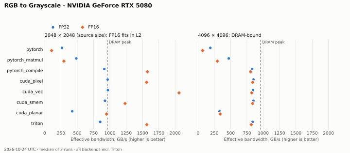

# Results

[← RGB to Grayscale](../README.md) · [Design](design.md) · **Results** ·
[Testing](testing.md) · [Benchmarking](benchmarking.md) · [Profiling](profiling.md)

**Benchmark session:** 2026-10-23 PDT (2026-10-24 UTC), cuda.0, RTX 5080,
CUDA toolkit 13.4.92, PyTorch 2.14.1+cu130, Triton 3.8.0, driver 615.71.09.
**All backends, including Triton, were remeasured together.** Current benchmark
tables use the median of three run medians, each from 100 CUDA-event samples after
25 warmups. Timing includes output allocation and call submission; compilation
is excluded. Inputs are reused, clocks are unlocked, and the desktop uses the GPU.
Each benchmark case passed its correctness gate before timing.

The updated chart uses this same session. The older CUDA/PyTorch Nsight analysis
is retained in [Why the variants differ](#why-the-variants-differ), explicitly
separate from these new call timings. Compact per-run evidence and source hashes:
[measured_summary.json](../benchmarks/measured_summary.json). Raw samples and
full environment are in `artifacts/perf_20261023/rgb_to_grayscale/device_{1,2,3}.json`.

## DRAM-bound: 4096 × 4096

Latency in µs (lower is better); effective logical bandwidth in parentheses.
RGB kernels move `4·P·s` bytes. The image-copy control moves `6·P·s`, 1.5× as much,
so compare bandwidth rather than raw latency with the copy.

| 4096 × 4096 | FP32 | FP16 | BF16 |
|---|---:|---:|---:|
| copy reference | 491.776 (819 GB/s) | 244.832 (822 GB/s) | 245.296 (821 GB/s) |
| `pytorch` | 1422.800 (189 GB/s) | 1902.496 (71 GB/s) | 1903.040 (71 GB/s) |
| `pytorch_matmul` | 569.760 (471 GB/s) | 452.144 (297 GB/s) | 451.152 (298 GB/s) |
| `pytorch_compile` | 323.552 (830 GB/s) | 166.400 (807 GB/s) | 166.256 (807 GB/s) |
| `cuda_pixel` | 315.920 (850 GB/s) | 160.192 (838 GB/s) | 160.528 (836 GB/s) |
| `cuda_vec` | 318.656 (842 GB/s) | 162.992 (823 GB/s) | 145.536 (922 GB/s) |
| `cuda_smem` | 316.000 (849 GB/s) | 160.352 (837 GB/s) | 161.232 (832 GB/s) |
| `cuda_planar` | 813.104 (330 GB/s) | 394.864 (340 GB/s) | 361.888 (371 GB/s) |
| `triton` | 320.912 (836 GB/s) | 164.336 (817 GB/s) | 164.432 (816 GB/s) |

Triton reaches **836 GB/s FP32, 817 GB/s FP16 and 816 GB/s BF16**.
It is close to scalar CUDA FP32/FP16 at this size. Vector CUDA's BF16 result is
faster in this session; its three medians are retained in the summary rather than
explaining the gap using older profiler measurements.

## The source's size: 2048 × 2048

Latency in µs. The copy row still moves 1.5× the kernel's logical traffic.

| 2048 × 2048 | FP32 | FP16 | BF16 |
|---|---:|---:|---:|
| copy reference | 121.152 | 55.584 | 36.544 |
| `pytorch` | 252.992 | 314.656 | 320.672 |
| `pytorch_matmul` | 138.144 | 113.536 | 119.712 |
| `pytorch_compile` | 73.408 | 21.296 | 21.504 |
| `cuda_pixel` | 69.488 | 21.472 | 22.208 |
| `cuda_vec` | 69.232 | 16.288 | 16.112 |
| `cuda_smem` | 72.576 | 27.216 | 26.896 |
| `cuda_planar` | 158.864 | 35.360 | 35.360 |
| `triton` | 78.768 | 21.424 | 21.376 |

Triton FP16 takes **21.424 µs** (1,566 GB/s effective), compared with
**16.288 µs** (2,060 GB/s) for `cuda_vec`; Triton is 31.5% slower per call here.
BF16 is similar: 21.376 versus 16.112 µs. This is a cache-resident regime, so
bandwidth above the 960 GB/s DRAM peak reflects L2 reuse. The performance gap is
measured; attributing it to a particular Triton instruction or stall requires a
new profiler capture. The historical CUDA/PyTorch analysis below explains why
wide accesses are useful in this regime, without claiming Triton counters.

Triton's run-median spread at 4096² is 0.7% FP32 and 0.2% or less for FP16/BF16;
at 2048² it is 2.5% FP32 and 0.2% or less for FP16/BF16.

## Why the variants differ

**Historical profiler evidence:** all counters and kernel-only timings in this
section are from the earlier CUDA 13.2 CUDA/PyTorch study. There is no new Triton
Nsight capture in this benchmark follow-up.

Nsight Compute, one launch per report ([how to capture and read](profiling.md)). ncu
locks clocks and times the kernel alone, so its durations differ from the tables above;
compare the kernels with each other.

### 1. Bytes: every fused kernel is at the lower bound

| 4096² FP32, caches flushed | Time | DRAM read | L2 read sectors | DRAM busy |
|---|---:|---:|---:|---:|
| *lower bound (`3·P·s` read; no kernel can read less)* | — | *201.3 MB* | *6.29 M* | — |
| `cuda_pixel` | 262.1 µs | 201.3 MB | 6.29 M | 93.9% |
| `cuda_vec` | 263.8 µs | 201.4 MB | 6.29 M | 93.8% |
| `cuda_smem` | 264.4 µs | 201.3 MB | 6.29 M | 94.0% |
| `pytorch_compile` | 264.5 µs | 201.3 MB | 6.29 M | 93.9% |
| `cuda_planar`: planar kernel only | 264.2 µs | 201.3 MB | 6.29 M | 94.0% |
| `cuda_planar`: + `deinterleave_rgb` | + 438.2 µs | + 201.3 MB | + 6.29 M | 88.1% |
| `pytorch` (5 kernels) | 1162 µs | **872 MB** | 27.3 M | ~93% |
| `pytorch_matmul` | 579.0 µs | 201.4 MB | 6.29 M | **46.6%** |

The italic row is computed, not measured. In FP16 the picture is the same: the fused kernels
read exactly 100.7 MB at 93–96% DRAM throughput, in 114–133 µs. The FP16 spread there
follows how much output each launch happened to write back during its run (2.9–16.7 MB),
and the order changes between ncu and the benchmark, so it is not a property of the kernels.

- **The stride-3 access costs nothing at the DRAM level.** `cuda_pixel`'s loads touch 12
  sectors per request instead of 4, but the second and third channel loads hit the sectors
  the first one brought into L1 (66.7% L1 hit rate), so L2 sees exactly the lower bound.
  `cuda_vec` (32 sectors per request, 50% L1 hit) and `pytorch_compile` (24, 83%) rely on
  the same reuse; only `cuda_smem` asks for exactly the bytes it needs (16 sectors per
  512-byte request, no reuse needed), and gains nothing from it.
- **The eager reference reads the image 3 times.** Each `0.299 * rgb[..., 0]` reads one
  channel through a strided view, which touches every sector of the image: three 201 MB
  reads, plus two adds over 134 MB of intermediates, 4.3× the lower bound. In FP16 it also
  converts the whole image to FP32 first, so it falls further behind.
- **`pytorch_matmul` is not memory-bound.** It reads the minimum, but cuBLAS's GEMV kernel
  reduces over an inner dimension of 3: half-empty or 3-lane warps (Source page), 19
  instructions per pixel against 0.3–2.5 for the others, and issue slots 62% (FP32) to 80%
  (FP16) busy. DRAM is busy only 47% (FP32) and 28% (FP16) of the time.
- **A planar layout would not help.** The planar kernel alone (perfectly contiguous loads)
  takes the same 264 µs as the interleaved kernels, so even data that is already planar
  gains nothing here; converting costs another 438 µs.

### 2. When the image is in L2: instructions and L2 bandwidth

| 2048² FP16, image in L2 | Kernel time | L2 throughput | Issue slots busy | Instructions / pixel | Top stall |
|---|---:|---:|---:|---:|---|
| `cuda_vec` | **7.7 µs** | **90.8%** | 25% | 0.32 | long scoreboard |
| `pytorch_compile` | 8.2 µs | 84.8% | 65% | 0.91 | long scoreboard |
| `cuda_planar`: planar kernel only | 12.9 µs (+31.0 convert) | 55.1% | 39% | 0.94 | long scoreboard |
| `cuda_pixel` | 14.0 µs | 49.2% | 45% | 1.19 | long scoreboard |
| `cuda_smem` | 20.2 µs | 34.0% | 53% | 2.07 | **barrier** |

All five hit L2 for 100% of sectors and leave DRAM idle (2–3%). With DRAM out of the way,
the limit becomes L2 bandwidth, and only kernels that issue few, wide requests reach it.
`cuda_vec` moves 33.5 MB in 7.7 µs (4.4 TB/s) with three 16-byte loads and one 16-byte
store per 8 pixels. `cuda_pixel` needs three 2-byte loads per pixel and reaches half the L2
bandwidth. `cuda_smem` executes 6.5× the instructions of `cuda_vec` (global → shared copy,
barrier, three shared loads), waits at `__syncthreads()`, and its FP16 shared loads have
2-way bank conflicts (about one extra cycle per load: 0.41 M conflicts over 0.39 M loads).
In FP32 at this size, every kernel is again 36–39 µs at 92–94% DRAM busy: 67 MB does not
fit beside other data in the 64 MiB L2.

### 3. Occupancy and registers

| 4096², caches flushed | `cuda_pixel` | `cuda_vec` | `cuda_smem` | `pytorch_compile` |
|---|---:|---:|---:|---:|
| Registers per thread (FP32 / FP16) | 16 / 16 | 40 / 25 | 36 / 34 | 16 / 17 |
| Warps active (FP32) | 74% | 83% | 93% | 85% |
| Issue slots busy (FP32) | 7.7% | 2.3% | 18.4% | 5.8% |

None of these limits a DRAM-bound launch: all four keep DRAM 94% busy.

## Small images

Complete-call latency in µs. Small cases are sensitive to Python submission gaps
and clock/cache state; these are not kernel-only durations.

| 48 × 64 | FP32 | FP16 | BF16 |
|---|---:|---:|---:|
| copy reference | 6.240 | 6.240 | 6.080 |
| `pytorch` | 21.664 | 26.672 | 26.592 |
| `pytorch_matmul` | 17.072 | 15.264 | 15.072 |
| `pytorch_compile` | 20.224 | 19.536 | 19.584 |
| `cuda_pixel` | 11.328 | 10.912 | 10.976 |
| `cuda_vec` | 11.136 | 10.944 | 10.928 |
| `cuda_smem` | 11.104 | 10.912 | 11.040 |
| `cuda_planar` | 13.280 | 13.216 | 13.056 |
| `triton` | 13.312 | 13.664 | 13.584 |

| 1024 × 1024 | FP32 | FP16 | BF16 |
|---|---:|---:|---:|
| copy reference | 10.096 | 6.288 | 6.272 |
| `pytorch` | 25.264 | 36.544 | 36.576 |
| `pytorch_matmul` | 43.872 | 39.680 | 39.920 |
| `pytorch_compile` | 19.840 | 19.744 | 19.488 |
| `cuda_pixel` | 12.928 | 12.864 | 12.720 |
| `cuda_vec` | 12.960 | 11.040 | 15.136 |
| `cuda_smem` | 15.072 | 15.040 | 14.640 |
| `cuda_planar` | 21.152 | 17.248 | 17.280 |
| `triton` | 15.264 | 18.128 | 13.664 |

At 1024², Triton's FP16 run medians range **13.744–18.368 µs**; FP32 ranges
15.184–18.848 µs. This is much less stable than the large cases. Do not interpret
the small-case ranking as a precise kernel throughput comparison. Every run's
median and min–max range is retained in the compact summary.

## Decisions

The profiler-based explanations below refer to the historical capture session.
The new measurements support retaining `cuda_vec` for cache-resident inputs;
Triton is competitive at the large DRAM-bound size but slower at 2048² FP16/BF16.

- **`cuda_vec` is the recommended kernel.** At DRAM-bound sizes it ties with the others
  (within 1% of the best in the profiler); with the image in L2 it is the fastest, at 91% of
  L2 bandwidth with the fewest instructions. It needs a 16-byte aligned image and falls
  back to `cuda_pixel` otherwise. `cuda_pixel` is the simplest kernel that reaches the DRAM
  limit.
- **The three-channel stride is not a DRAM problem.** L1 absorbs it, so DRAM and L2
  traffic stay at the lower bound; it costs instructions and L1/L2 throughput, which shows
  only when the data is cache-resident.
- **`cuda_smem` is not worth its complexity:** it fixes a coalescing "problem" that L1
  already solves and adds a barrier, 2–8× the instructions and FP16 bank conflicts. Its
  slight lead in the DRAM-bound benchmark (≤ 4%) does not appear in the profiler.
- **Converting to planar costs more than it saves:** 2.6× slower, and the planar kernel by
  itself is no faster than the interleaved ones at DRAM-bound sizes.
- **`torch.compile` is the honest PyTorch baseline:** its kernel matches ours at 4096² and is
  within 7% of `cuda_vec` from L2; what remains is its 19.5 µs call cost. It must be
  compiled per shape (or carefully), since its dynamic-shape kernel can be 6× slower
  depending on the first image it saw ([design](design.md#implementations)). The eager
  reference is the correctness oracle only; `image @ w` is a poor substitute for a fused
  kernel.

## Validation

- Original CUDA/PyTorch study on RTX 5080: **529 passed**, 86 skipped before
  Triton was implemented. Current Triton validation is documented below.
- Compute Sanitizer: memcheck **0 errors** in 344 CUDA tests (including misaligned images
  that take the fallback); racecheck **0 hazards**, synccheck and initcheck **0 errors** on
  the 172 `cuda_vec` and `cuda_smem` tests.

## Limitations

- One desktop GPU with unlocked clocks; buffers are reused between samples.
- The benchmark times whole Python calls; kernel-only comparisons come from single ncu
  launches, which run at base clocks.
- The benchmark tables and figure include Triton; historical profiling still
  covers CUDA/PyTorch only. Small-case run variation is reported above.

New benchmark JSON is in `artifacts/perf_20261023/rgb_to_grayscale/`. Historical
Nsight reports remain in `results/rtx5080/`. See [benchmarking](benchmarking.md)
for reproduction.

## Triton implementation follow-up (2026-10-23)

The explicit Triton backend is now implemented. Combined GPU validation for
problems 4 and 5: **1,373 passed, no skips**. Triton-only memcheck: **227 passed,
zero errors**. See [testing](testing.md#triton-validation-2026-10-23) for commands
and coverage. The same-day performance follow-up now includes three matched
all-backend runs in the tables and chart above.
